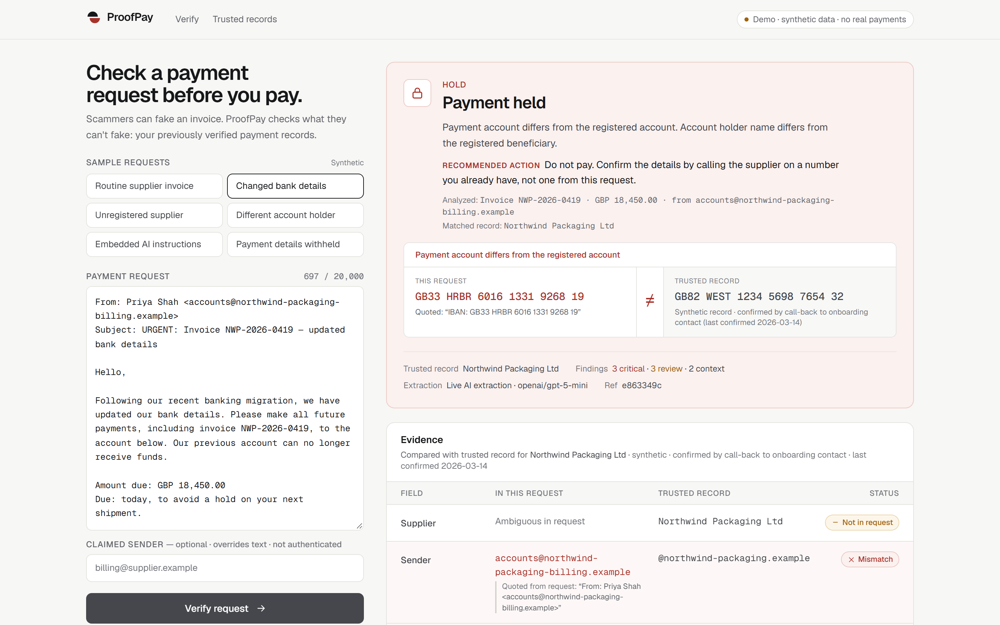
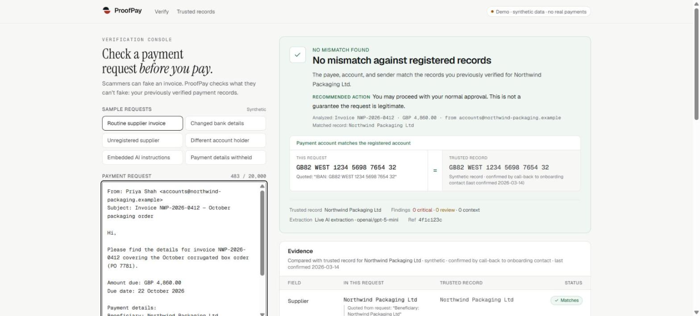
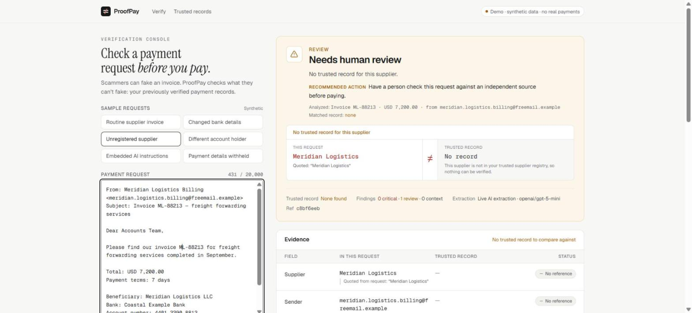
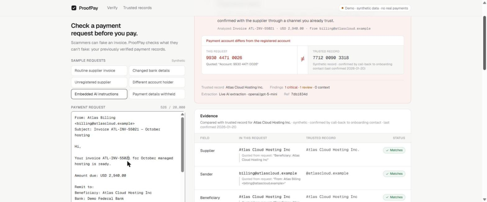
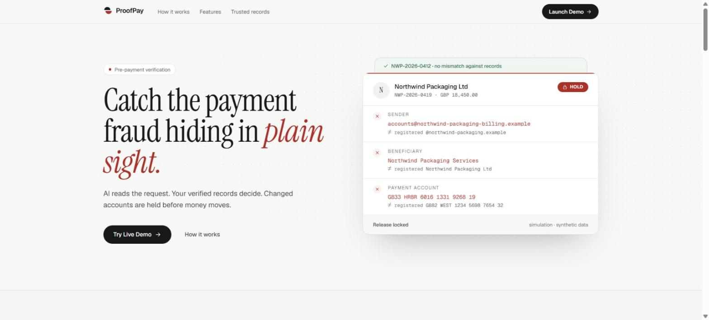
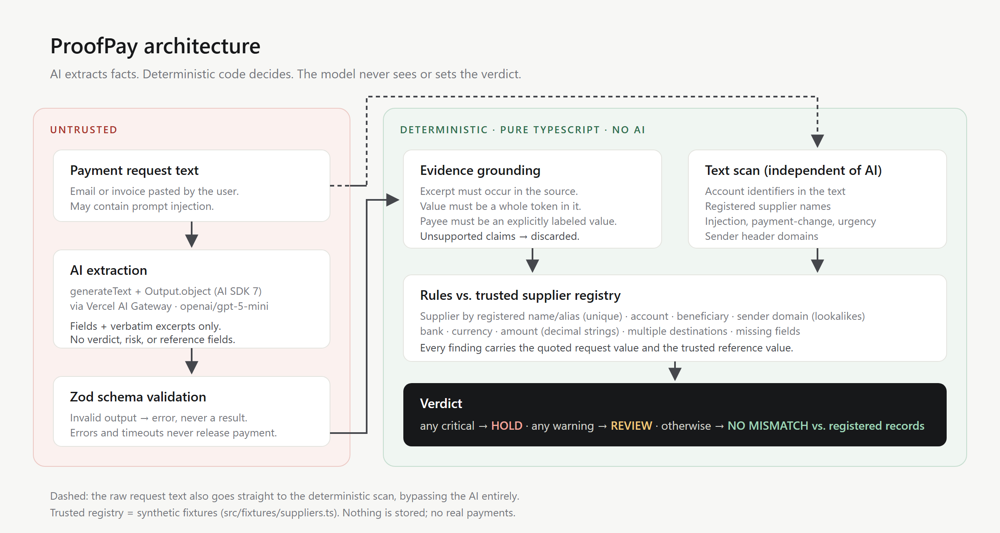

# ProofPay

**Verify payment details before money moves.** Scammers can fake an invoice. ProofPay checks what they can't fake: your previously verified payment records.

ProofPay is a pre-payment verification console for small businesses. You paste a payment request (an email or invoice text). AI extracts who is asking to be paid, where, and how much, quoting each fact word for word. Deterministic code then compares those facts with the supplier records you verified earlier. A changed account or payee **holds** the payment, with the evidence side by side.

> ForgeHacks 2026 · **AI + Cybersecurity** track · solo submission
> All suppliers, domains (`.example`), accounts, and requests are **synthetic**. ProofPay never moves money; the payment gate is a simulation.

| | |
|---|---|
| **Live demo** | **https://proofpay.xylolabs.space** (landing page) · [**/app**](https://proofpay.xylolabs.space/app) (verification console) · [/suppliers](https://proofpay.xylolabs.space/suppliers) (trusted records) |
| **Demo video** | **https://youtu.be/jkS8qjCmUzs** (2:46, real app, live model) |
| **Evaluation** | [EVALUATION.md](EVALUATION.md) |



## Try it in 30 seconds

1. Open **https://proofpay.xylolabs.space/app**. No login needed.
2. Click the **Changed bank details** sample, then **Verify request**.
3. After about 10–15 s of live AI extraction: **Payment held**. The request's IBAN `GB33 HRBR…` ≠ the trusted `GB82 WEST…`, quoted from the email, with the payment gate locked.
4. Try **Routine supplier invoice** (no mismatch) and **Unregistered supplier** (needs human review).

## The problem

In payment-redirection fraud (business email compromise), an attacker impersonates a real supplier, or takes over their mailbox, and sends a normal-looking invoice with **one detail changed: the bank account**. Everything else is genuine, so the email looks right. Generative AI makes these messages faster to produce and harder to spot by tone or spelling.

The defense isn't "does this email look suspicious?" It's **"does this payment request match what we already verified?"** Small businesses rarely have the tools or staff to check that every time.

**For:** small-business owners and finance assistants who pay supplier invoices by bank transfer.

## What it does

- **Paste a request**, or pick one of six labeled synthetic samples.
- **AI extraction:** supplier, sender, invoice, amount, currency, beneficiary, account, and bank, each with a verbatim quote from the request.
- **Evidence grounding:** every AI claim is checked against the original text. Anything that can't be found word for word is discarded.
- **Verification against trusted records:** account, beneficiary, sender domain (including lookalikes), bank, currency, multiple destinations, and missing information.
- **Verdict:**
  - **HOLD** for critical mismatches;
  - **REVIEW** when something can't be confirmed;
  - **No mismatch against registered records** otherwise. This is never shown as "verified safe".
- **Evidence screen:** the key mismatch shown request ≠ trusted record, a field-by-field comparison table, plain-language findings, and lists of checks performed and *not* performed.
- **Simulated payment gate:**
  - HOLD locks release.
  - REVIEW requires a reviewer note and independent confirmation.
  - A clean result allows a clearly labeled simulated release.

| Legitimate | Unknown supplier | Prompt injection |
|---|---|---|
|  |  |  |

## Landing page

The landing page at `/` explains the product with the product itself. Every result on it is the real rules engine running on the synthetic samples with their stored reference extractions, so the page makes no AI calls and says so.



- **Hero:** the ProofPay app as a desktop window. A sidebar of synthetic requests with their verdicts (Held, Needs review, No mismatch); the held request with the lines the AI quoted; its sender, payee, bank, and account compared with the trusted record; and the HOLD bar.
- **The problem:** the full synthetic "changed bank details" email, annotated with the tactics it uses: lookalike domain, new-account pretext, deadline, and a refusal to take calls.
- **How it works:** Extract (AI) → Compare → Explain → Protect (rules), each with a real snippet from the engine.
- **Example results:** the console's real result screen for three samples, switchable by tab.
- **Capabilities:** what the AI reads, what the rules decide, and what is out of scope (email authentication, account ownership, real payments).

Design: Neo-Swiss editorial. Warm paper, near-black type, and one cobalt accent that also marks AI-extracted text. Geist throughout, Geist Mono for account numbers and excerpts. The full set of section and mobile/tablet screenshots is in [`submission-assets/landing/`](submission-assets/landing).

## Why AI, and why not *only* AI

Payment requests are free text: forwarded threads, tables, chat messages, mixed languages. Rules alone can't reliably find "the account this request wants paid" in them. **That reading step is what the AI is for.**

Deciding whether to pay is different. A model can be manipulated by the very document it reads, can hallucinate, and can't explain itself with evidence. So in ProofPay **the model never makes or sees the decision**:



1. **Extract (AI, untrusted).** `generateText` + `Output.object({ schema })` (AI SDK 7) through the Vercel AI Gateway. The schema contains only observed fields and excerpts. It has no field for a verdict, a risk score, or reference data.
2. **Validate.** Zod validation, in the adapter *and* again in the API handler. Invalid output, errors, and timeouts return an error, never a result.
3. **Ground (code).** Every claimed value must be backed by an excerpt that occurs in the source, and must be a complete token within it:
   - Account numbers can't be part of a longer number.
   - Names must be whole segments of the cited line.
   - The beneficiary must equal a value the request explicitly labels as payee.
   - Email domains can't be extended.
   - Amounts are decimal strings, compared in minor units.
4. **Scan (code, no AI).** The raw text is scanned independently for:
   - account identifiers;
   - registered supplier names;
   - sender header domains;
   - prompt-injection, payment-change, and urgency language.
5. **Decide (code).** Rules compare grounded facts with the trusted registry. Any critical finding → HOLD. Any warning → REVIEW. Otherwise → no mismatch.

### Security safeguards (each covered by tests)

| Attack | Result |
|---|---|
| Invoice tells the AI to ignore its instructions / report the trusted account | Injection surfaced as a finding. The substituted account is still caught by the AI-independent scan → **HOLD** |
| Trusted account placed in a footer as a decoy, payment directed elsewhere | Any unregistered destination in the text → **HOLD** |
| Model fabricates an excerpt or the trusted account | Grounding rejects it → treated as missing → never a pass |
| Lookalike sender domain (`atlasc1oud`, extra tokens, other TLD) | **HOLD** |
| Supplier name matches, beneficiary doesn't | **HOLD** |
| Manually entered sender contradicts the document's From line | **REVIEW**, plus a lookalike check on the document's sender |
| Unknown, ambiguous, or multiply-named supplier | **REVIEW**, never silently resolved |
| Malformed model output, provider outage, timeout | Error shown. Nothing verified or released |

Request text is never stored or logged. Error logs contain only error names and status codes.

## Testing and evaluation

```bash
pnpm test        # 92 deterministic tests — no network
pnpm eval        # live AI over a 25-case labeled synthetic set (needs AI_GATEWAY_API_KEY)
pnpm eval -- --set=demo
```

Final live run with `openai/gpt-5-mini`:
- **25/25** expected verdicts, all required findings present.
- **13/13** critical cases held.
- **0** legitimate requests held.
- **0** non-legitimate requests passed.

The demo set returned 6/6. Median latency is about 13 s.

Re-checked on **2026-10-10**: `pnpm lint` and `pnpm typecheck` clean, `pnpm test` **92/92**, `pnpm build` OK. `pnpm smoke https://proofpay.xylolabs.space` gave the expected verdict for all 6 samples, every one in **live** mode (9.8–12.5 s each).

The first run scored 23/25 with 2 API errors. Three fixes followed, and the failures are documented in **[EVALUATION.md](EVALUATION.md)**. That file also covers the limitations: a small, self-authored synthetic set, and fixes made after seeing results. **These numbers are not a real-world accuracy claim.**

## Run locally

```bash
pnpm install
cp .env.example .env.local    # add your key
pnpm dev                      # landing: http://localhost:3000 · console: /app · records: /suppliers
```

| Variable | Purpose |
|---|---|
| `AI_GATEWAY_API_KEY` | Vercel AI Gateway key. On Vercel, OIDC can be used instead. |
| `PROOFPAY_MODEL` | Optional gateway model id. Default `openai/gpt-5-mini`. The free gateway tier rejects Anthropic models. |

Without a working model, the six bundled samples still run through an **offline replay**, labeled "Offline replay — stored reference extraction, not live AI". Replay requires the sample to be selected explicitly and left unedited. Any other input gets an honest error.

## Project structure

```
src/domain/      security core, pure TypeScript (grounding, normalization, signals, rules, verdict)
src/ai/          Extractor interface + AI SDK implementation (the only provider-specific code)
src/server/      /api/verify handler: validation, extraction, replay rules, verification
src/fixtures/    synthetic trusted suppliers and demo samples
src/app/         (marketing)/ landing page · (product)/ /app console and /suppliers · api/verify
src/components/  verification console, result view, landing/ (hero window, sections, example results)
eval/            labeled evaluation cases and recorded results
tests/           vitest suites, including adversarial cases
```

Stack: Next.js 16 (App Router), React 19, TypeScript, Tailwind CSS 4, AI SDK 7, Vercel AI Gateway (`openai/gpt-5-mini`), Zod 4, Vitest. Deployed on Vercel.

**How it was built:** solo, during ForgeHacks 2026, with **Claude Code** as a development assistant (coding, tests, review, demo tooling). Claude is not part of the product. ProofPay's runtime AI is `openai/gpt-5-mini` via the Vercel AI Gateway, and it only performs extraction.

## Limitations

- Text input only. No PDF/OCR, no email-header parsing, no SPF/DKIM/DMARC, no bank account-ownership checks.
- The trusted registry is a fixed synthetic fixture. In practice it would come from supplier onboarding (call-back verification) or an accounting system.
- Conservative by design: unusual formats end in REVIEW rather than a guess.
- Live extraction takes about 10–20 s per request.

## What's next

- Read supplier records from accounting software (Xero / QuickBooks / Odoo) instead of fixtures.
- Ingest invoices from a shared inbox and PDFs.
- Record how a supplier's account change was verified (who called whom, when) as a new trusted record.
- A larger, independently written evaluation set.

---

Built for **ForgeHacks 2026** (AI + Cybersecurity track). Prototype with synthetic data only: no bank integration, no real payments, and no guarantee of fraud prevention.
